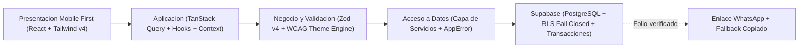

# Online Store Platform

**Autor y Propietario Exclusivo:** [JoNa](https://github.com/jona-datasol)  
**Licencia:** Propietaria — Todos los derechos reservados (`Copyright (c) 2026 JoNa`).

---

## Vision del Proyecto

Plataforma comercial hibrida de comercio electronico disenada bajo estandares senior de ingenieria de software: catalogo online publico Mobile First + solicitudes transaccionales de compra mediante WhatsApp + panel administrativo responsive con inventario trazable y configuracion 100% dinamica desde la interfaz.

## Arquitectura y Stack Tecnologico

- **Frontend:** React, TypeScript (Strict), Vite, Tailwind CSS v4, React Router, TanStack Query, Zod, Lucide Icons.
- **Backend y Datos:** Supabase (PostgreSQL, Auth, Storage, Row Level Security y funciones RPC transaccionales).
- **Calidad y Testing:** ESLint, Prettier, Vitest, Testing Library, Playwright (4 viewports Mobile First).
- **Infraestructura y Despliegue:** Vercel + GitHub Actions CI/CD.

## Capacidades Clave de Ingenieria

- **Configuracion 100% Dinamica:** Identidad de marca, colores (con contraste automatico WCAG 2.2 AA), moneda, impuestos, numero/horario WhatsApp y politicas gestionadas desde la interfaz administrativa (`site_settings`).
- **Diseno Mobile First y Accesibilidad:** Sistema de diseno modular (_Precision Retail_), areas tactiles >= 44px, tablas administrativas adaptativas y estandar WCAG 2.2 AA.
- **Integridad Comercial y Seguridad:** Recalculo de precios/promociones en servidor, bloqueo transaccional `FOR UPDATE` contra sobreventa, snapshots inmutables en pedidos, inventario append-only y politicas RLS Fail Closed.
- **Flujo WhatsApp Transaccional:** Persistencia previa obligatoria en base de datos con `idempotency_key` antes de generar el enlace prellenado de WhatsApp y respaldo de copiado.

## Arquitectura de 5 Capas y Flujo Transaccional

## Retos de Ingenieria Resueltos

- **Tematizacion dinamica accesible (WCAG 2.2 AA):** Sanitizacion estricta HEX anti-inyeccion CSS, calculo deterministico de luminancia relativa y derivacion automatica de colores de texto/borde con ratio >= 4.5:1 en tiempo real (`src/lib/theme.ts`).
- **Optimizacion de rendimiento y bundle:** Particionado determinista de vendors (`manualChunks`) combinado con `React.lazy` en rutas administrativas y secundarias, reduciendo el chunk inicial de `782.97 kB` a **`278.97 kB` (`86.61 kB` gzip)** sin advertencias de tamano.
- **Integridad comercial y anti-sobreventa:** Recalculo de precios/promociones en servidor, bloqueo determinista de filas en operaciones criticas, inventario append-only y snapshots inmutables en pedidos.
- **Seguridad Fail Closed y privacidad:** Politicas RLS por defecto denegadas, sanitizacion automatica de PII en la capa de errores (`src/lib/errors.ts`), whitelist estricta de imagenes sin SVG ejecutable y pruebas automatizadas contra fugas de secretos (`tests/unit/securityBundle.test.ts`).

## Estado del Proyecto (Roadmap)

- **Fase 0 — Reconocimiento y Gobernanza:** Completada.
- **Sprint 1 — Arquitectura, Producto, Seguridad, Design System y Toolchain CI/CD:** Completado y aprobado.
- **Sprint 2 — Migraciones SQL/RLS/Storage (auditadas), Capa Base de Servicios/Errores, Libreria UI Base y Motor Dinamico de Temas (WCAG 2.2 AA):** Completado y aprobado (29 pruebas unitarias en verde).
- **Sprint 3 — MVP Publico (Catalogo Mobile First, Ficha de Producto con Variantes/JSON-LD, Carrito Persistente y Flujo Transaccional WhatsApp):** Completado y aprobado (43 pruebas unitarias en verde).
- **Sprint 4 — MVP Administrativo (Auth Admin Fail Closed, CRUD Catalogo/Storage, Inventario Trazable, Pedidos 8 Estados, Clientes, Configuracion Dinamica `site_settings` con Vista Previa WCAG 2.2 AA y Code Splitting `React.lazy`):** Completado y aprobado (51 pruebas unitarias en verde).
- **Sprint 5 — Promociones, Reportes Reales en Servidor, Optimizacion de Bundle (`index.js` `278.97 kB` / `86.61 kB` gzip, 0 warnings) y Suite QA E2E Playwright (4 viewports Mobile First):** Completado y aprobado (57 pruebas unitarias en verde).
- **Sprint 6 — Release Readiness v1.0.0 y Despliegue a Produccion:** Completado y verificado.

## Contenido Verificable de Este Repositorio Publico (Portafolio)

Para acreditar la ingenieria real y autoria exclusiva de **[JoNa](https://github.com/jona-datasol)** protegiendo la propiedad intelectual y la seguridad del backend privado, este repositorio publico incluye una seleccion auditada de modulos reutilizables, pruebas y configuracion de produccion:

- **Motor Dinamico de Temas WCAG 2.2 AA:** `src/lib/theme.ts`, `src/styles/tokens.css` y `tests/unit/theme.test.ts` (sanitizacion HEX anti-inyeccion CSS, calculo deterministico de luminancia/contraste y tokens semanticos Tailwind v4).
- **Libreria UI Mobile First (10 primitivos):** `src/components/ui/` (`Button`, `Input`, `Badge`, `Alert`, `Card`, `DataTable` con Stacked Card List `< 768px`, `EmptyState`, `Modal`, `Skeleton`).
- **Taxonomia de Errores y Tipos Base:** `src/lib/errors.ts`, `src/types/common.ts` y `tests/unit/errors.test.ts` (`ServiceResult<T>`, `AppError`, sanitizacion PII).
- **Seguridad y Calidad Automatizada:** `tests/unit/securityBundle.test.ts`, `eslint.config.js`, `tsconfig*.json` (Strict), `vite.config.ts` (`manualChunks`), `vitest.config.ts`, `playwright.config.ts` (4 viewports Mobile First) y `vercel.json` (headers de seguridad HTTP).

> Los modulos de negocio llave en mano (`src/modules/`, `src/services/`), las migraciones SQL/RLS/RPC (`supabase/`) y la documentacion interna permanecen en el repositorio privado de **JoNa**.

## Autoria y Propiedad Intelectual

Disenado, arquitectado y desarrollado exclusivamente por **[JoNa](https://github.com/jona-datasol)**.  
El codigo fuente, migraciones SQL y especificaciones internas se mantienen privados bajo licencia propietaria. Consulta [AUTHORSHIP.md](./AUTHORSHIP.md) y [LICENSE](./LICENSE).
