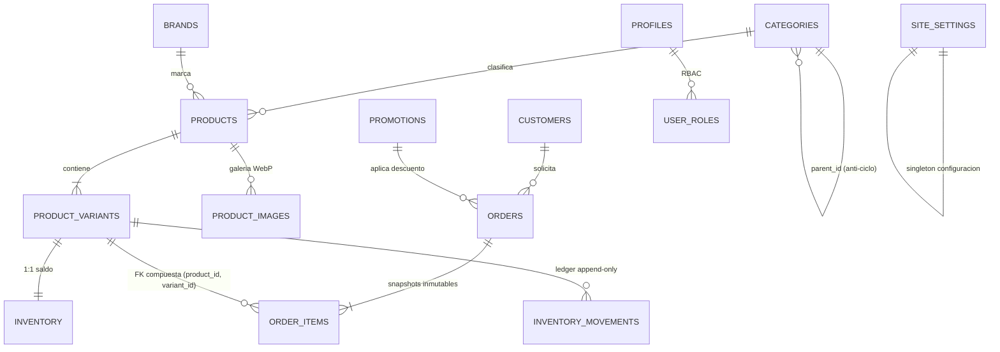

# Modelo Entidad-Relación e Invariantes de Integridad (Sanitizado)

**Autor y Propietario Exclusivo:** [JoNa](https://github.com/jona-datasol)  
**Motor:** PostgreSQL 15+ (Supabase) con Row Level Security y transacciones ACID.

---

## Diagrama Entidad-Relación Simplificado

---

## Invariantes Críticas Garantizadas en PostgreSQL (No Solo en Frontend)

| Dominio | Invariante | Mecanismo en Base de Datos |
| :--- | :--- | :--- |
| **Inventario** | `available_quantity` nunca queda desactualizado | Columna `GENERATED ALWAYS AS (quantity - reserved_quantity) STORED` + `CHECK (quantity >= 0 AND reserved_quantity >= 0 AND reserved_quantity <= quantity)`. |
| **Historial de Stock** | Ningún rol puede editar ni borrar movimientos históricos | Tabla `inventory_movements` append-only (trigger/políticas bloquean `UPDATE` y `DELETE`) + `idempotency_key` única por operación. |
| **Catálogo / Pedidos** | Una variante en `order_items` siempre pertenece al `product_id` indicado | Clave foránea compuesta `(product_id, variant_id)` hacia `UNIQUE (product_id, id)` en `product_variants`. |
| **Variante por Defecto** | Solo una variante predeterminada por producto | Índice único parcial `WHERE is_default = true`. |
| **Precios** | El precio comparativo nunca es inferior al precio efectivo | `CHECK (compare_at_price IS NULL OR compare_at_price > price)`. |
| **Categorías** | Sin ciclos jerárquicos (`A -> B -> A`) | Trigger recursivo `BEFORE INSERT OR UPDATE` recorriendo `parent_id`. |
| **Promociones** | Sin combinaciones inválidas de alcance, fechas o usos | Constraints compuestos: `% <= 100`, exclusividad `scope_type` (`product` vs `category` vs `global`), `ends_at >= starts_at`, `current_uses <= max_uses`. |
| **Pedidos (Estados)** | Solo transiciones comerciales válidas entre los 8 estados | Trigger `BEFORE UPDATE` que valida la máquina de estados (ej. bloquea `delivered -> pending_whatsapp` o `cancelled -> preparing`). |
| **Pedidos (Totales)** | Coherencia matemática de montos | `CHECK (total = GREATEST(0, subtotal - discount_amount + tax_amount))`. |
| **Telemetría** | Sin abuso de escritura ni retención indefinida | Rate-limit en servidor + retención automatizada de 90 días. |
