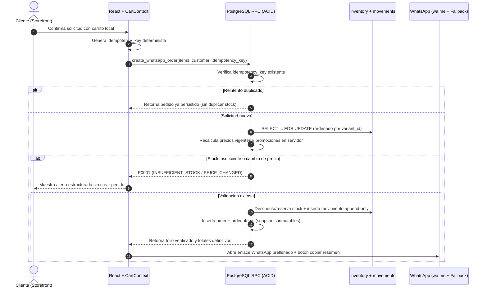

# Flujo Transaccional y Evidencia de Pruebas de Concurrencia

**Autor y Propietario Exclusivo:** [JoNa](https://github.com/jona-datasol)

---

## Secuencia del Checkout Transaccional por WhatsApp

---

## Matriz de Verificación: Pruebas Negativas, Concurrencia e Idempotencia

Suite ejecutada directamente contra PostgreSQL (Sprint 12) con reversión limpia (`ROLLBACK`) y complementada con pruebas unitarias y E2E:

| # | Escenario Evaluado | Comportamiento Esperado | Resultado |
| :-: | :--- | :--- | :---: |
| 1 | Compra concurrente de la última unidad (2 sesiones simultáneas) | Una transacción confirma bajo `FOR UPDATE`; la segunda falla con `INSUFFICIENT_STOCK`; nunca queda saldo negativo. | Aprobado |
| 2 | Reintento duplicado con la misma `idempotency_key` | Retorna la orden existente sin duplicar pedido ni descuento de inventario. | Aprobado |
| 3 | Cambio de precio entre carrito y confirmación | El servidor detecta la discrepancia y aplica regla autoritativa (`PRICE_CHANGED` / precio vigente del servidor). | Aprobado |
| 4 | Inserción en `order_items` con `variant_id` de otro `product_id` | Rechazado por FK compuesta `(product_id, variant_id)` (`23503`). | Aprobado |
| 5 | Promoción porcentual `> 100%` o `ends_at < starts_at` o alcance cruzado | Rechazado por constraints `CHECK` en `promotions` (`23514`). | Aprobado |
| 6 | Transición de estado inválida (`delivered -> pending_whatsapp`, `cancelled -> preparing`) | Rechazado por trigger SQL de máquina de estados en `orders` (`P0001`). | Aprobado |
| 7 | Creación de ciclo en jerarquía de `categories` (`A -> B -> A`) | Rechazado por trigger recursivo anti-ciclos (`P0001`). | Aprobado |
| 8 | Intento de `UPDATE` o `DELETE` sobre `inventory_movements` | Bloqueado por política append-only del ledger. | Aprobado |
| 9 | `compare_at_price <= price` o incoherencia matemática en totales de `orders` | Rechazado por constraints `CHECK` (`23514`). | Aprobado |
| 10 | Solicitud falsificada cross-origin hacia `POST /api/track` | Rechazada con HTTP `403` por validación Same-Origin en servidor. | Aprobado |

---

## Cobertura Automatizada Complementaria

- **Pruebas unitarias (Vitest):** Motor WCAG 2.2 AA (`theme.test.ts`, incluyendo fronteras `0.04045` y superficies oscuras), normalizador de errores Fail Closed (`errors.test.ts`), guardia de secretos en fuente y bundle (`securityBundle.test.ts`), motor de analítica IA, carrito, utilidades WhatsApp y validadores.
- **Pruebas E2E (Playwright):** 20 casos verificados en producción sobre 4 viewports Mobile First (`360px`, `390px`, `768px`, `1280px`).
